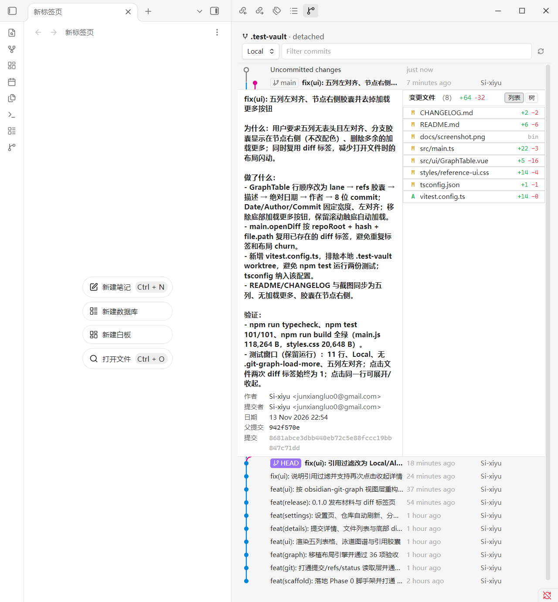

# DSH Git Graph

一个 **桌面端** Obsidian 插件：在右侧面板显示当前 vault 的 Git 提交图，交互参照 VS Code Git Graph。




## 功能

- 四列无表头、全部左对齐：`Graph | Description | Date | Author`；refs 胶囊在节点右侧，日期用相对时间。
- 点击提交在列表内**就地展开**详情：作者/提交者、日期、父提交、完整 message、文件变更（列表/树切换、状态色、`+n/-n`）；再次点击收起。
- 点击文件在**新的编辑器标签页**打开该文件的 Git diff：hunk、旧/新行号、增删底色、虚拟滚动；同一提交+文件会复用已打开的标签。
- 右侧面板随仓库变化自动刷新（`fs.watch(.git)` + 300ms 去抖），面板关闭即停止监听。
- 设置：Git 可执行文件、每页提交数（10–5000）、引用过滤（`local`/`all`）、日期格式。
- 大仓库（>1000 行）只渲染可视区 ±20 行，图谱仍是单个 SVG；展开详情使用引擎的 `expandedRow` 偏移。
- 非仓库、git 缺失、命令失败都有明确状态；错误会原样显示 git stderr 并提供重试。

## 安装

### 从 release 安装

1. 从 release 下载 `main.js`、`manifest.json`、`styles.css`。
2. 在 vault 中创建目录：

   ```text
   <vault>/.obsidian/plugins/dsh-git-graph/
   ```

3. 把三个文件放进该目录。
4. 在 Obsidian「设置 → 第三方插件」中关闭安全模式并启用 **DSH Git Graph**。
5. 点击左侧 ribbon 的 Git 分支图标，或执行命令 **Open Git Graph**。

### 从源码构建

```bash
npm install
npm run build
```

构建产物在 `dist/main.js`、`dist/styles.css`；连同根目录 `manifest.json` 一起放入上面的插件目录。

## 发布（维护者）

推送 `x.y.z` 标签会触发 `.github/workflows/release.yml`。标签必须与 `manifest.json` 的 `version`
完全一致、**不带 `v` 前缀**——Obsidian 按 manifest 里的版本号查找同名 tag 的 release 来下载插件文件：

1. 先把 `manifest.json`、`package.json`、`versions.json`、`CHANGELOG.md` 的版本改成同一个版本并提交。
2. 创建并推送标签：

   ```bash
   git tag -a 0.1.0 -m "DSH Git Graph 0.1.0"
   git push origin 0.1.0
   ```

3. GitHub Actions 会依次执行 `npm ci`、`typecheck`、`test`、`build`，校验 tag 与 manifest 版本一致，
   然后创建 GitHub Release，附带：
   - `manifest.json`
   - `main.js`（来自 `dist/main.js`）
   - `styles.css`（来自 `dist/styles.css`）
   - `versions.json`
   - `dsh-git-graph-<version>.zip`（前三件套）

也可以在 Actions 页面手动触发 `Release` 并填入一个已存在的 tag。

## 使用

- **打开面板**：ribbon 图标或命令面板里的 `Open Git Graph`。面板默认在右侧栏。
- **查看提交**：点击任意行，详情就地展开；再次点击同一行可收起。点击文件列表里的文件，会打开一个 diff 标签页。
- **引用过滤**：顶部 `Local` 只显示本地分支和标签；`All` 还显示远端跟踪引用（悬停下拉框有说明）。
- **搜索**：搜索框按描述、作者、hash、ref 过滤（过滤时隐藏图谱）。
- **加载更多**：滚动到列表底部 25px 内自动加载下一页（没有单独的按钮）。
- **设置**：Obsidian 设置 → 第三方插件 → DSH Git Graph：
  - `Git 可执行文件`：默认 `git`，也可以填绝对路径（例如 Windows 的 `C:\Program Files\Git\cmd\git.exe`）。
  - `每页提交数`：10–5000，默认 200。
  - `引用过滤`：`local` 只显示本地分支与标签，`all` 还包含远端跟踪引用。
  - `日期格式`：列表与详情共用，默认 `DD Mon YYYY HH:mm`；支持 `YYYY`、`YY`、`MM`、`M`、`DD`、`D`、`Mon`、`HH`、`H`、`mm`、`ss`。

## 限制

- **仅桌面端**：需要访问本机 `git` 进程；`manifest.json` 的 `isDesktopOnly` 为 `true`。
- **需要本机 git**：插件不内置 git，也不联网；找不到 `git` 时会在面板中显示错误。
- **只读**：不做 checkout/commit/push/pull 等写操作。
- **diff 只预览文本**：二进制文件显示提示；超大文件/超长行仍可能受内存与渲染限制。
- **性能**：布局引擎对极端拓扑（大量提交共同指向末行）存在 O(n²) 风险；超过 1000 行已做行虚拟化。
- **测试覆盖**：不包含 Obsidian 端到端自动化测试；手动验收使用隔离测试 vault。

## 开发

```bash
npm install
npm run typecheck   # vue-tsc --noEmit
npm test            # vitest run
npm run build       # tsc --noEmit && vite build
```

主要目录：

```text
src/git/      git 进程、提交/refs/status、详情与 diff 解析
src/graph/    布局引擎移植、数据装配、详情缓存、仓库 watcher
src/ui/       GraphHeader、提交列表、SVG 画布、详情、diff 查看器
src/view.ts   Obsidian ItemView（右侧面板）
src/diffView.ts  Obsidian ItemView（diff 标签页）
src/settings* 设置模型与设置页
tests/        vitest：引擎契约/黄金基准、git 真仓库、分页/缓存/watcher
```

## 许可

MIT © 2026 Si-xiyu。行为与视觉规范参考 VS Code Git Graph，未使用其代码；第三方声明见
[THIRD_PARTY_NOTICES.md](THIRD_PARTY_NOTICES.md)。
