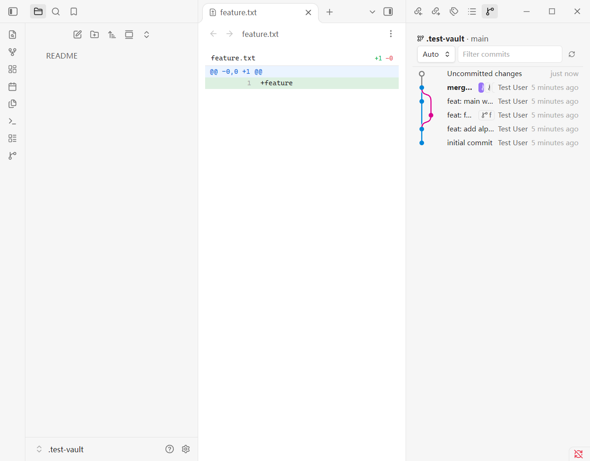

# Visible Git Graph

A desktop-only Obsidian plugin that shows your vault's Git history as an interactive commit graph. It is **read-only**: it never commits, checks out, fetches, pulls or pushes.




## Features

- A four-column, left-aligned list — `Graph | Description | Date | Author` — with ref capsules next to the commit node and relative dates.
- Click a commit to expand its details in place: author and committer, dates, parents, the full message, and the changed files (list/tree toggle, status colours, `+n/-n`). Click it again to collapse.
- Click a file to open its Git diff in a new editor tab: hunks, old/new line numbers, add/delete backgrounds and virtual scrolling. Opening the same commit and file again reuses the existing tab.
- The pane refreshes itself when the repository changes (`fs.watch(.git)` with a 300 ms debounce); the watcher stops when the pane closes.
- Large repositories (more than 1000 rows) render only the visible window plus 20 rows on each side, while the graph stays a single SVG. Expanded details use the engine's `expandedRow` offset.
- Clear states for "not a repository", "git not found" and command failures. Git's stderr is shown as-is, with a retry button.

## Requirements

- Obsidian **1.7.2** or newer, desktop only.
- `git` installed. If it is not on `PATH`, set the executable in the plugin settings.

## Install

### From a release

1. Download `main.js`, `manifest.json` and `styles.css` from the release.
2. Create this folder in your vault:

   ```text
   <vault>/.obsidian/plugins/visible-git-graph/
   ```

3. Put the three files in that folder.
4. In Obsidian, open **Settings → Community plugins**, turn off Restricted mode and enable **Visible Git Graph**.
5. Click the Git branch icon in the ribbon, or run **Open Git Graph** from the command palette.

### From source

```bash
npm install
npm run build
```

The build writes `dist/main.js` and `dist/styles.css`. Copy them together with `manifest.json` into the plugin folder above.

## Usage

- **Open the pane**: the ribbon icon or **Open Git Graph**. It opens in the right sidebar.
- **Inspect a commit**: click any row to expand its details in place; click it again to collapse. Click a file to open its diff tab.
- **Filter refs**: `Local` shows local branches and tags; `All` also shows remote-tracking refs.
- **Search**: filters by description, author, hash or ref (the graph is hidden while filtering).
- **Load more**: scrolling within 25 px of the bottom loads the next page automatically.
- **Settings**:

| Setting | Default | Meaning |
|---|---|---|
| Git executable | `git` | Command or absolute path used to run git. |
| Commits per page | 200 | How many commits are loaded at once (10–5000). |
| Refs to show | `Local` | `Local`: local branches and tags. `All`: also remote-tracking refs. |
| Date format | `DD Mon YYYY HH:mm` | Shared by the list and details. Supports `YYYY`, `YY`, `MM`, `M`, `DD`, `D`, `Mon`, `HH`, `H`, `mm`, `ss`. |

## What this plugin accesses

This plugin is desktop-only because it uses Node.js APIs. It runs `git` and reads the repository's `.git` directory; it never writes to the repository.

- **The `git` process**: `child_process.execFile` (never a shell) runs read-only commands such as `rev-parse`, `log`, `for-each-ref`, `status`, `show` and `diff-tree`. There is no commit, checkout, fetch, push or pull.
- **The `.git` directory**: `fs` reads it and `fs.watch` watches it so the pane can refresh. When the vault is a folder inside a larger repository, that directory is outside the vault.
- **Vault files**: opened through Obsidian's vault API only.
- **No network requests, no telemetry, no analytics.**

## Limitations

- Desktop only; needs a local `git`.
- Read-only.
- Diff preview is text-only: binary files show a notice; very large files or lines may hit memory or rendering limits.
- The layout engine has an O(n²) risk on extreme topologies (many commits converging on the last row); rows beyond 1000 are virtualized.
- No automated Obsidian end-to-end tests; manual checks use an isolated test vault.

## Development

```bash
npm install
npm run typecheck   # vue-tsc --noEmit
npm test            # vitest run
npm run build       # tsc --noEmit && vite build
```

Main folders:

```text
src/git/      git process, commits/refs/status, details and diff parsing
src/graph/    layout engine port, data assembly, detail cache, repository watcher
src/ui/       GraphHeader, commit list, SVG canvas, details, diff viewer
src/view.ts   Obsidian ItemView (side pane)
src/diffView.ts  Obsidian ItemView (diff tab)
src/settings*  settings model and settings tab
tests/        vitest: engine contract/golden, real git repos, pagination/cache/watcher
```

## License

MIT © 2026 Si-xiyu. Product behaviour and visual layout reference VS Code Git Graph; no code from that project is used. Third-party notices: [THIRD_PARTY_NOTICES.md](THIRD_PARTY_NOTICES.md).

---

## 中文

一个**桌面端** Obsidian 插件：在右侧面板显示当前 vault 的 Git 提交图，交互参照 VS Code Git Graph。只读，不做 commit/checkout/fetch/push。

### 功能

- 四列无表头、全部左对齐：`Graph | Description | Date | Author`；refs 胶囊在节点右侧，日期用相对时间。
- 点击提交在列表内**就地展开**详情：作者/提交者、日期、父提交、完整 message、文件变更（列表/树切换、状态色、`+n/-n`）；再次点击收起。
- 点击文件在**新的编辑器标签页**打开该文件的 Git diff：hunk、旧/新行号、增删底色、虚拟滚动；同一提交+文件会复用已打开的标签。
- 右侧面板随仓库变化自动刷新（`fs.watch(.git)` + 300ms 去抖），面板关闭即停止监听。
- 设置：Git 可执行文件、每页提交数（10–5000）、引用过滤（`local`/`all`）、日期格式。
- 大仓库（>1000 行）只渲染可视区 ±20 行，图谱仍是单个 SVG；展开详情使用引擎的 `expandedRow` 偏移。
- 非仓库、git 缺失、命令失败都有明确状态；错误会原样显示 git stderr 并提供重试。

### 安装

从 release 下载 `main.js`、`manifest.json`、`styles.css`，放进 `<vault>/.obsidian/plugins/visible-git-graph/`，然后在「设置 → 第三方插件」中启用 **Visible Git Graph**。

源码构建：`npm install && npm run build`，产物在 `dist/main.js`、`dist/styles.css`。

### 使用

- **打开面板**：ribbon 图标或命令面板里的 `Open Git Graph`。面板默认在右侧栏。
- **查看提交**：点击任意行，详情就地展开；再次点击同一行可收起。点击文件列表里的文件，会打开一个 diff 标签页。
- **引用过滤**：顶部 `Local` 只显示本地分支和标签；`All` 还显示远端跟踪引用。
- **搜索**：搜索框按描述、作者、hash、ref 过滤（过滤时隐藏图谱）。
- **加载更多**：滚动到列表底部 25px 内自动加载下一页。
- **设置**：Git 可执行文件、每页提交数（10–5000，默认 200）、引用过滤、日期格式（默认 `DD Mon YYYY HH:mm`）。

### 访问范围

插件只使用桌面端 Node API：用 `execFile` 运行 `git` 的只读命令（`rev-parse`、`log`、`for-each-ref`、`status`、`show`、`diff-tree`），用 `fs` 读取并 watch 仓库的 `.git`；vault 是仓库子目录时 `.git` 在 vault 之外。不写仓库、不联网、无遥测。

### 限制

- 仅桌面端，需要本机 `git`。
- 只读；diff 只预览文本，二进制文件显示提示。
- 极端拓扑下布局引擎仍有 O(n²) 风险；超过 1000 行已做行虚拟化。
- 不包含 Obsidian 端到端自动化测试；手动验收使用隔离测试 vault。

### 发布（维护者）

推送 `x.y.z` 标签会触发 `.github/workflows/release.yml`。标签必须与 `manifest.json` 的 `version` 完全一致、**不带 `v` 前缀**。工作流会执行 `typecheck`、`test`、`build`，然后：

1. 创建 GitHub Release，只附带 `manifest.json`、`main.js`、`styles.css`；
2. 为这三个文件生成 artifact attestation；
3. `versions.json` 只留在仓库里，不上传到 release。

```bash
git tag -a 0.2.2 -m "Visible Git Graph 0.2.2"
git push origin 0.2.2
```

也可以在 Actions 页面手动触发 `Release` 并填入一个已存在的 tag。

### 许可

MIT © 2026 Si-xiyu。行为与视觉规范参考 VS Code Git Graph，未使用其代码；第三方声明见 [THIRD_PARTY_NOTICES.md](THIRD_PARTY_NOTICES.md)。
