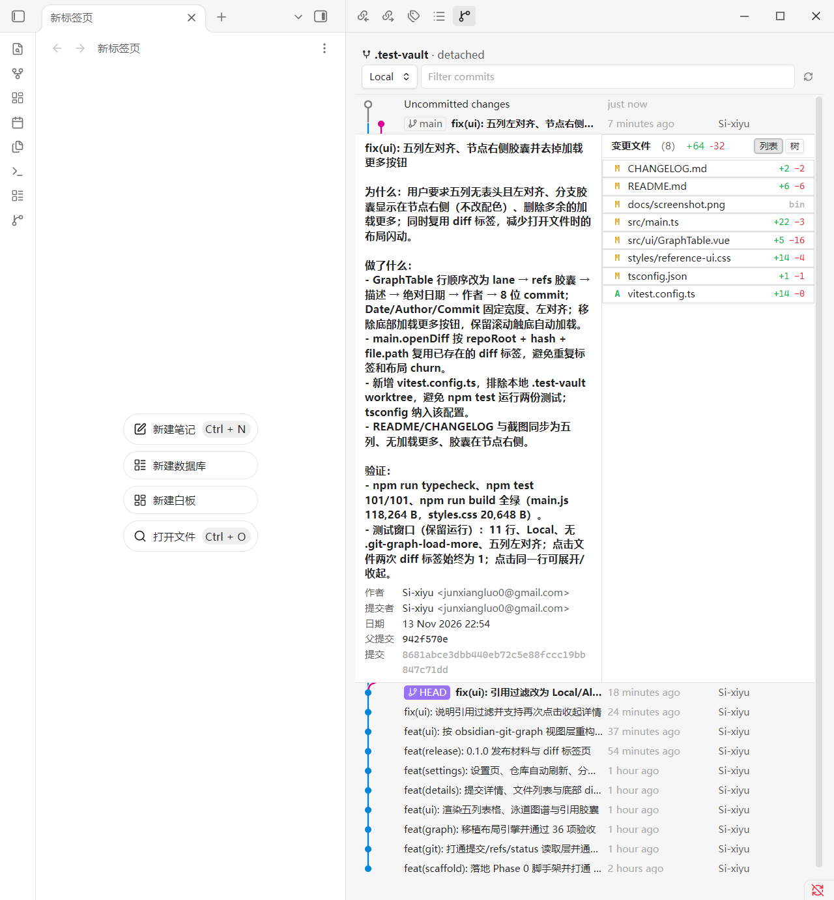
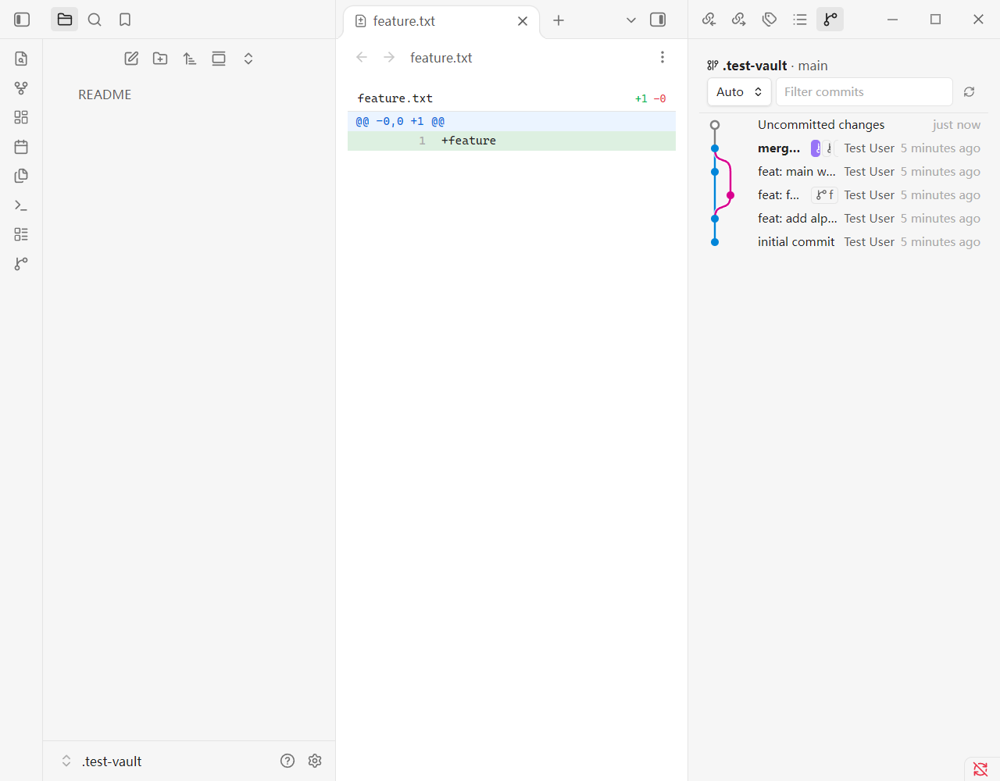

<p align="center"><strong>Visible Git Graph</strong> 是一个桌面端 Obsidian 插件：把 vault 所在仓库的 Git 提交历史变成可交互的提交图——提交、引用、行内详情和文件 diff，都在右侧面板里。</p>

<p align="center">
  
</p>

<p align="center"><a href="README.md">English</a> | 简体中文</p>

---

Visible Git Graph 读取 vault 所在的 Git 仓库，按 VS Code 源代码管理图的方式画出来。点击提交可以在列表内就地展开 message 和变更文件；点击文件会在新的编辑器标签页打开该提交的 diff。

插件是**只读**的：不做 commit、checkout、fetch、pull、push，也不发起任何网络请求。

<p align="center">
  
</p>

## 快速开始

### 一行命令安装

把 `VAULT` 改成你的 vault 路径，然后整段运行。它会把三个 release 文件下载到插件目录。

**macOS / Linux**

```sh
VAULT="/path/to/your/vault"
PLUGIN="$VAULT/.obsidian/plugins/visible-git-graph"
mkdir -p "$PLUGIN"
BASE="https://github.com/Si-xiyu/obsidian-visible-git-graph/releases/latest/download"
for f in main.js manifest.json styles.css; do
  curl -fL "$BASE/$f" -o "$PLUGIN/$f"
done
```

**Windows（PowerShell）**

```powershell
$Vault  = "C:\path\to\your\vault"
$Plugin = Join-Path $Vault ".obsidian\plugins\visible-git-graph"
New-Item -ItemType Directory -Force $Plugin | Out-Null
$Base   = "https://github.com/Si-xiyu/obsidian-visible-git-graph/releases/latest/download"
foreach ($f in "main.js", "manifest.json", "styles.css") {
  Invoke-WebRequest "$Base/$f" -OutFile (Join-Path $Plugin $f)
}
```

然后在 Obsidian 打开 **设置 → 第三方插件**，关闭安全模式并启用 **Visible Git Graph**。如果 Obsidian 已经打开，复制完文件后在应用内按 **Ctrl/Cmd + R** 重载。

### 从社区目录安装

插件上架后，打开 **设置 → 第三方插件 → 浏览**，搜索 **Visible Git Graph**，然后 **安装** 并 **启用**。

### 手动安装

从 [最新 release](https://github.com/Si-xiyu/obsidian-visible-git-graph/releases/latest) 下载 `main.js`、`manifest.json`、`styles.css`，放进：

```text
<vault>/.obsidian/plugins/visible-git-graph/
```

### 让 agent 帮你装

把下面这段粘贴给你的编码 agent（Claude Code、Codex、DSH 等）：

```text
Install the Obsidian plugin "Visible Git Graph" from
https://github.com/Si-xiyu/obsidian-visible-git-graph into my vault.

1. Use this vault path: <VAULT_PATH>.
2. Create <VAULT_PATH>/.obsidian/plugins/visible-git-graph/ if it does not exist.
3. Download the latest release assets:
   https://github.com/Si-xiyu/obsidian-visible-git-graph/releases/latest/download/main.js
   https://github.com/Si-xiyu/obsidian-visible-git-graph/releases/latest/download/manifest.json
   https://github.com/Si-xiyu/obsidian-visible-git-graph/releases/latest/download/styles.css
4. Verify all three files exist and are non-empty, and that manifest.json contains
   "id": "visible-git-graph".
5. Do not modify any other file in the vault. Tell me to enable the plugin in
   Settings → Community plugins.
```

给 agent 的机器可读安装说明：[AGENTS.md](AGENTS.md)。

## 功能

- **提交图**：分支着色的泳道、紧凑行、本地分支/远端分支/标签/`HEAD` 胶囊，日期用相对时间。
- **行内提交详情**：作者、提交者、日期、父提交、完整 message，以及变更文件（列表/树切换、状态色、`+n/-n`）。
- **diff 标签页**：点击文件在新标签页打开 diff，包含 hunk、旧/新行号、增删底色和虚拟滚动；同一提交+文件会复用标签。
- **自动刷新**：监听仓库的 `.git` 目录，300ms 去抖后刷新；面板关闭即停止监听。
- **大仓库**：超过 1000 行时只渲染可视区 ±20 行，图谱仍是单个 SVG。
- **清晰的错误状态**：非仓库、git 缺失、命令失败都有明确提示；git stderr 原样显示并带重试。

## 使用

- **打开面板**：点击左侧 ribbon 的 Git 分支图标，或执行命令 **Open Git Graph**。面板默认在右侧栏。
- **查看提交**：点击任意行就地展开详情；再次点击收起。点击文件打开 diff 标签页。
- **引用过滤**：`Local` 只显示本地分支和标签；`All` 还包括远端跟踪引用。
- **搜索**：按描述、作者、hash、ref 过滤；过滤时隐藏图谱。
- **加载更多**：滚动到列表底部 25px 内自动加载下一页。

## 系统要求

- Obsidian **1.7.2** 或更新版本，仅桌面端。
- 安装 `git`。如果 `git` 不在 `PATH` 中，在插件设置里填写它的绝对路径。

## 设置

| 设置 | 默认值 | 说明 |
|---|---|---|
| Git 可执行文件 | `git` | 运行 git 的命令或绝对路径。 |
| 每页提交数 | 200 | 每次加载多少条提交（10–5000）。 |
| 引用过滤 | `Local` | `Local`：本地分支和标签。`All`：还包括远端跟踪引用。 |
| 日期格式 | `DD Mon YYYY HH:mm` | 列表与详情共用。支持 `YYYY`、`YY`、`MM`、`M`、`DD`、`D`、`Mon`、`HH`、`H`、`mm`、`ss`。 |

## 访问范围

插件是桌面端插件，因为使用了 Node.js API。它运行 `git` 并读取仓库的 `.git` 目录，不写仓库。

- **`git` 进程**：`child_process.execFile`（不经过 shell）运行只读命令，如 `rev-parse`、`log`、`for-each-ref`、`status`、`show`、`diff-tree`；没有 commit、checkout、fetch、push、pull。
- **`.git` 目录**：用 `fs` 读取、用 `fs.watch` 监听，以便面板刷新；vault 是更大仓库的子目录时，该目录在 vault 之外。
- **vault 文件**：只通过 Obsidian 的 vault API 打开。
- **不联网、无遥测、无统计。**

## 限制

- 仅桌面端，需要本机 `git`。
- 只读。
- diff 只预览文本：二进制文件显示提示；超大文件或超长行可能触到内存/渲染上限。
- 布局引擎在极端拓扑（大量提交共同指向末行）下有 O(n²) 风险；超过 1000 行已做行虚拟化。
- 不包含 Obsidian 端到端自动化测试；手动验收使用隔离测试 vault。

## 开发

```bash
npm install
npm run typecheck   # vue-tsc --noEmit
npm test            # vitest run
npm run build       # tsc --noEmit && vite build
```

主要目录：

```text
src/git/      git 进程、提交/refs/status、详情与 diff 解析
src/graph/    布局引擎移植、数据装配、详情缓存、仓库 watcher
src/ui/       GraphHeader、提交列表、SVG 画布、详情、diff 查看器
src/view.ts   Obsidian ItemView（右侧面板）
src/diffView.ts  Obsidian ItemView（diff 标签页）
src/settings* 设置模型与设置页
tests/        vitest：引擎契约/黄金基准、git 真仓库、分页/缓存/watcher
```

## 许可

MIT © 2026 Si-xiyu。行为与视觉规范参考 [VS Code Git Graph](https://github.com/mhutchie/vscode-git-graph)，未使用其代码。第三方声明见 [THIRD_PARTY_NOTICES.md](THIRD_PARTY_NOTICES.md)。
